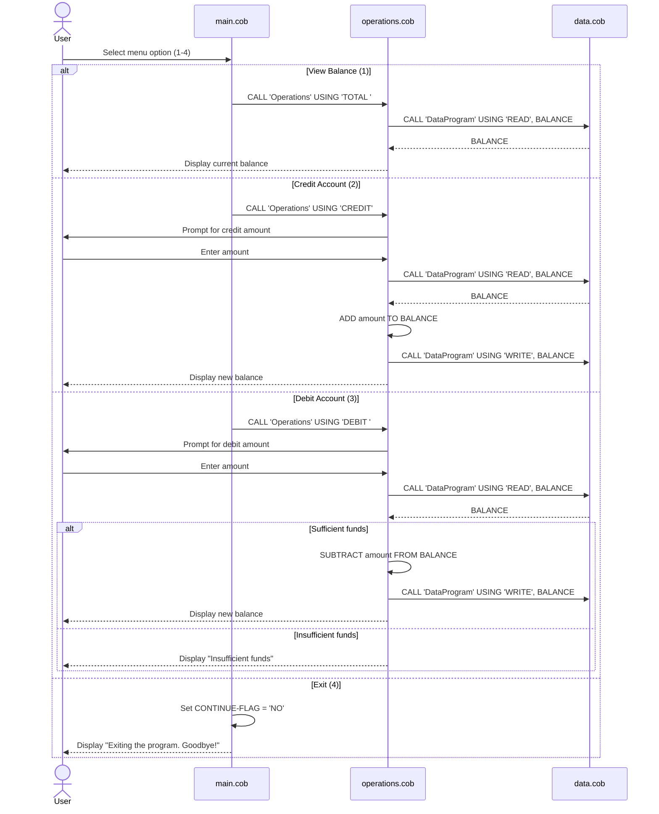

# Legacy COBOL Accounting System — Documentation

This document explains the purpose of each COBOL program in the school's legacy
accounting system (`src/cobol/`), their key functions, and the business rules
that govern student account operations.

## File Overview

### `main.cob`

`main.cob` is the entry point of the application and acts as the user
interface / menu controller. It:

- Displays a text menu with four options: View Balance, Credit Account,
  Debit Account, and Exit.
- Reads the user's numeric choice (`USER-CHOICE`).
- Dispatches the choice to the `Operations` program by calling
  `CALL 'Operations' USING ...` with an operation code (`'TOTAL '`, `'CREDIT'`,
  or `'DEBIT '`).
- Loops until the user selects option 4, which sets `CONTINUE-FLAG` to `'NO'`
  and exits the program.

### `operations.cob`

`operations.cob` contains the business logic for each account operation. It
receives the operation code from `main.cob` via the `LINKAGE SECTION` and:

- **TOTAL**: Reads the current balance from `data.cob` and displays it.
- **CREDIT**: Prompts for an amount, reads the current balance, adds the
  amount, and writes the new balance back via `data.cob`.
- **DEBIT**: Prompts for an amount, reads the current balance, and — only if
  sufficient funds are available — subtracts the amount and writes the new
  balance back. Otherwise it displays "Insufficient funds for this debit."

### `data.cob`

`data.cob` is the data access layer. It owns the single piece of persistent
state in the system, `STORAGE-BALANCE`, and exposes two operations through its
`LINKAGE SECTION`:

- **READ**: Copies `STORAGE-BALANCE` into the caller's `BALANCE` variable.
- **WRITE**: Copies the caller's `BALANCE` into `STORAGE-BALANCE`.

## Business Rules

- Every student account starts with an initial balance of **1000.00**
  (`VALUE 1000.00` in both `operations.cob` and `data.cob`).
- Balances are stored as `PIC 9(6)V99`, i.e. unsigned numbers with up to 6
  integer digits and 2 decimal places — balances cannot go negative in
  storage format.
- **Debits are only allowed if the account balance is greater than or equal to
  the debit amount.** If funds are insufficient, the debit is rejected and no
  balance change occurs.
- Credits always succeed and simply increase the balance by the entered
  amount.
- All reads/writes to the balance go through `data.cob` — `operations.cob`
  never touches storage directly, which keeps the data access logic
  centralized in a single place.

## Data Flow Diagram

